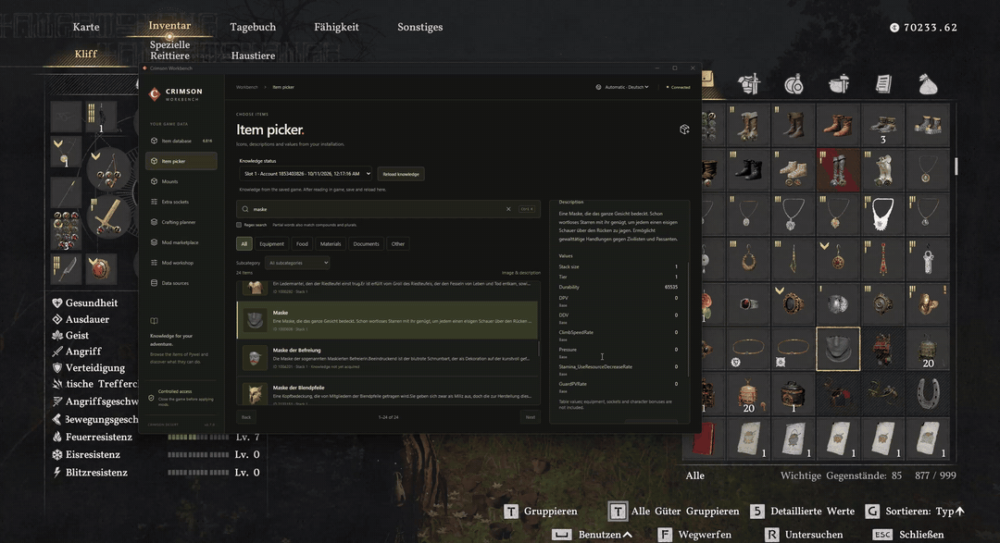

# Crimson Workbench

**macOS port preview:** native Apple Silicon packaging, Steam discovery, verified
item browsing and crafting are available in this branch. Game/save writes and
Windows runtime modules remain unsupported. See [macOS usage and build notes](docs/MACOS.md).

Free, open-source Windows tools for your local Crimson Desert installation. Search and add items, manage mounts and equipment, plan crafting, and install mods from one app.

**[Download for Windows](https://github.com/ArasHueseyin/crimson-workbench/releases/latest)** · [Installation](docs/INSTALLATION.md) · [Contributing](CONTRIBUTING.md) · [Report a problem or request a mod](https://github.com/ArasHueseyin/crimson-workbench/issues/new/choose)

Adding ten masks while the game is running. This recording shows an earlier Workbench interface.

## What you can do

- **Item Picker:** search localized items with icons and add supported items to your inventory while playing.
- **Mounts and equipment:** register supported mounts, add extra sockets to supported equipment, and manage their stones.
- **Mod Marketplace:** install and configure skills, journal knowledge, inventory settings, movement mods, live time/weather controls and more. Each card shows when it can be used.
- **Crafting and Mod Workshop:** plan materials, preview edits to game data, and review changes before applying them.
- **Backups and recovery:** preview supported save changes and game-file transactions, keep backups, and restore managed changes.

See the [Marketplace guide](docs/MARKETPLACE.md) for individual mods and limits, or the [documentation index](docs/README.md) for detailed guides.

## Install and compatibility

Download the setup EXE from [Releases](https://github.com/ArasHueseyin/crimson-workbench/releases/latest). It includes the app, loader and optional game modules; no developer tools or separate mod ZIP are needed. Close the game before installing modules. The installer is currently unsigned, and each release includes SHA-256 checksums.

You need Windows x64 and your own game installation. Native modules require the supported **EXE 1.0.0.2976** and its matching hash; catalog reading also supports earlier observed builds. After game updates, affected features may need an update. Check [build support](docs/BUILD_SUPPORT.md) before using a different build.

The interface is in English. Item names follow the installed Steam language when detected, with English as the fallback and a manual language selector. Some features work live; others require the game to be closed. Follow the availability label on each card.

## Contribute

Start with [CONTRIBUTING.md](CONTRIBUTING.md) for the PR workflow and [the developer guide](docs/DEVELOPMENT.md) for setup, a code map and test commands. Frontend and synthetic tests can run without owning the game. CI checks Windows and Linux; packaged releases and game modules target Windows.

Bug reports, feature requests, mod ideas and feedback are welcome through the [issue forms](https://github.com/ArasHueseyin/crimson-workbench/issues/new/choose).

## License and credits

Original Workbench code is licensed under [MIT](LICENSE). Dependencies retain their own licenses; see [credits](CREDITS.md) and [third-party notices](THIRD_PARTY_NOTICES.md). Crimson Desert belongs to Pearl Abyss; this is an independent project. Game archives, saves and personal configurations are not distributed.
