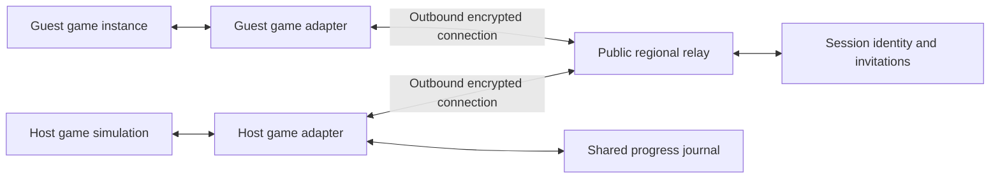

# Internet multiplayer feasibility

Checked on 11 October 2026 against Workbench release `v0.8.0` and the locally installed Windows x64 game EXE `1.0.0.2976`. This study covers internet sessions, PvP, shared quests, and newly authored dungeons. It assesses implementation paths and records actual read-only checks; it does not add a multiplayer feature to Workbench.

**Decision:** proceed with a small internet multiplayer research prototype. A release containing PvP, shared campaign quests, and new dungeon maps is not yet supported by the available evidence. The main unresolved dependency is a stable second player participating in the game's authoritative simulation.

## Findings by requested feature

| Feature | Assessment | Evidence and missing proof |
| --- | --- | --- |
| Internet sessions across different home networks | Technically feasible transport design; actual two-PC game test pending | Two outbound TLS WebSocket clients reached a public internet service. A hosted relay would avoid inbound router configuration. Room authentication, two-network routing, reconnects, and regional performance remain to be built and tested. |
| Visible two-player co-op | Conditional research path | Local actor type names and several community byte fingerprints exist in this build. Creating, owning, animating, and removing a remote actor across loading boundaries have not been demonstrated by our code. |
| Private, mutually enabled PvP | Conditional on native combat integration | Damage-related fingerprints are candidates. Valid targeting, hit detection, damage, death, resurrection, and remote-player attribution are unverified. Changing another actor's HP is insufficient evidence of PvP. |
| Competitive public PvP | Not ready | A relay only moves messages. A modified player-hosted game cannot provide a strong fairness guarantee. Independently controlled authoritative combat and abuse-resistant session handling would be additional requirements. |
| Shared existing quests | Not proven | Client/server quest-manager type names exist, but the runtime quest dispatcher and safe progress/reward write path are unverified. Different save progress, cutscenes, choices, and reconnects need explicit rules. |
| New dungeon encounters in existing locations | Conditional on actor/world integration | Custom encounter rules are a possible first content target. Enemy spawn ownership, navigation, gates, loot, reset, and synchronized completion still need proof. This does not satisfy the separate requirement for new maps. |
| Newly authored dungeon maps | Feasibility unresolved | Workbench has no validated level-import, geometry/collision, navigation-generation, or dungeon-registration pipeline. Archive/table editing alone does not establish that a new playable level can be loaded. |

## Checks performed

### Installed executable, read only

The own-code [static probe](../../scripts/research/multiplayer_static_probe.py) opened the EXE for reading and mapped it with `ACCESS_READ`. The observed SHA-256 was:

```text
57da440d72f4db974f25fef047cf84c4dadd999a88cb2a3c5af4c9bd67fde1e7
```

PE timestamp: `1790086912`; image size: `389722112`. Both match the current Workbench runtime pins. The inventory found 15,840 unique matching MSVC type-name strings. Broad keyword groups contained 12 player/actor candidates, 1,142 network/message candidates, 155 combat candidates, 398 quest candidates, and 255 dungeon/world candidates. Groups overlap and include unrelated types; their counts are not implemented features.

Exact names included `ClientUserActor`, `CommonUserActor`, `ServerUserActor`, `ClientQuestManager`, `CommonQuestManager`, and `ServerQuestManager` in the `pa` namespace. No names containing `Dungeon`, `PVP`, `Pvp`, `PvP`, or `PartyManager` were found by this narrow string scan. Absence of a matching name does not demonstrate absence of a feature or hidden code.

Twelve public research fingerprints from `blizz3010/CrimsonDesertCoop` commit `c0a89386c57bc645a95586537dbaad148e9ccce7` were checked against executable PE sections:

| Fingerprint | Executable-section candidates |
| --- | ---: |
| POSITION_PRIMARY / POSITION_FALLBACK | 1 each |
| DAMAGE_SLOT_PRIMARY / DAMAGE_VALUE_PRIMARY | 1 each |
| WORLD_SYSTEM_P1 / P2 / P3 | 0 / 1 / 0 |
| CHILD_ACTOR_VTBL_P1 / P2 / P3 | 1 each |
| PLAYER_BASE_CHILDACTOR / PLAYER_BASE_DISCOVERY | 0 each |

Eight had a unique byte candidate and four had no match. Overlapping occurrences are counted, and data-only matches are excluded. These are byte matches, not validated hook sites, function signatures, calling conventions, pointer lifetimes, or safe execution contexts. No community function was invoked. Fingerprints, addresses, and downloaded source snapshots stay in ignored local research storage.

Existing [Live Items](../../runtime/live-items/src/runtime.cpp) already queues a narrowly defined inventory operation on a leased server-player task. Its [named pipe](../../runtime/live-items/src/pipe.cpp) explicitly rejects remote clients. That demonstrates a useful game-thread pattern, not a multiplayer session or additional player slot. The internet adapter must preserve that separation.

### Actual outbound internet check

The own-code [WebSocket probe](../../scripts/research/multiplayer_wss_probe.mjs) used Node's TLS WebSocket client with normal certificate verification and the public [Postman Echo endpoint](https://learning.postman.com/docs/reference/developer-resources/echo-api/). It sent only generated identifiers and sequence numbers.

Two clients on this one PC each received all ten exact echoed payloads. The observed round trips were 139–154 ms, with means of 146 ms and 145 ms. This establishes outbound WSS connectivity to that endpoint without opening a local listener. It does not establish peer routing, game-state replication, a deployed Workbench relay, connectivity from another household, or acceptable worldwide PvP latency. The measurement is a connectivity sample, not a regional benchmark.

### Probe regression checks

Seven synthetic PE tests passed: source preservation/type classification, data-section exclusion, overlapping-match ambiguity, unique-match limitations, literal regex bytes and wildcard handling, malformed/weak fingerprint rejection, and malformed PE rejection. The Node probe passed syntax checking. Synthetic test bytes are authored fixtures, not extracted game functions.

No game process was running during the inspection. No ASI was installed or injected, and no game file or save was changed. No public server was deployed.

## External evidence and reuse limits

The inspected [community source](https://github.com/blizz3010/CrimsonDesertCoop/tree/c0a89386c57bc645a95586537dbaad148e9ccce7) has Steam networking and companion/damage code. Its [quest/world receivers](https://github.com/blizz3010/CrimsonDesertCoop/blob/c0a89386c57bc645a95586537dbaad148e9ccce7/src/sync/world_sync.cpp) log events without applying quest progression, cutscenes, or interactions. Its presence is evidence of research paths, not proof of our build's compatibility.

The pinned tree contains no LICENSE/COPYING file and GitHub reports no detected license. It was read as a reference, with no code incorporated. Reuse needs a suitable license or permission; a public repository alone is insufficient. [GitHub licensing guidance](https://docs.github.com/en/repositories/managing-your-repositorys-settings-and-features/customizing-your-repository/licensing-a-repository)

A separate developer's [recent alpha report](https://www.reddit.com/r/CrimsonDesert/comments/1x1udzj/mod_crimson_desert_coop_mod_alpha_by_me_what_i/) describes Steam-relayed remote characters but unresolved differences between independently simulated worlds, including enemy behavior, damage attribution, loot, save progress, and pauses. These are author-reported observations, not independently reproduced results. They support prioritizing native second-player ownership over building more message forwarding around an unrecognized visual actor.

## Internet architecture

The baseline must work across home networks without assuming shared Wi-Fi, manual port forwarding, a VPN installation, or a fixed public player IP. A publicly reachable relay with outbound encrypted connections is the independent implementation path. Regional relays and measured session ping are necessary design considerations for distant players; worldwide reachability does not guarantee low latency between continents.



This is a proposed architecture. The relay forwards typed session messages; it does not run the game engine, calculate native hits, or make a guest into a real player. The host must remain the single authority for enemies, combat decisions, quest progress, and dungeon encounters. Host departure initially ends the session; reconnects use a fresh full snapshot and a session epoch rather than replaying stale actions.

For the first prototype, WSS on TCP 443 is a practical control/relay transport. Movement snapshots need sequence numbers, interpolation, stale-state rejection, and bounded queues. TCP head-of-line delays are a real concern for action combat; an unreliable UDP/QUIC relay or equivalent game transport should be evaluated before committing to production PvP. Reliable quest/reward events require IDs and duplicate rejection regardless of transport.

Steam networking is a separate possible implementation path that needs testing in the actual game's Steam context. Valve documents relayed Steam P2P and distinguishes it from the standalone open-source networking library, which does not itself grant SDR access. We cannot assume access to the game's publisher configuration or promise free Valve relay service for Workbench. [Valve SDR documentation](https://partner.steamgames.com/doc/features/multiplayer/steamdatagramrelay), [GameNetworkingSockets](https://github.com/ValveSoftware/GameNetworkingSockets)

An own relay would require hosting, TLS certificates, session authentication, bandwidth, monitoring, and ongoing operation. Those costs have not been priced or committed. Rooms need authenticated participants, expiring invitations, build/mod compatibility checks, limits on message size/rate, and bounded lifetime. Network packets must never specify raw memory addresses, executable scripts, or unrestricted local inventory/save writes.

## Feature-specific requirements

**PvP:** first target private duels with mutual opt-in, no damage in co-op mode, a clear end-of-duel state, and an agreed gear/mod profile. The game adapter must resolve both combatants as valid native targets, compute or validate attacks through confirmed engine paths, reject repeated attacks, and synchronize death/resurrection. Merely trusting a client's reported damage or maximum-HP value is unsuitable. Workbench's item/stat modifiers also mean competitive fairness is a separate problem; hiding their buttons would not solve it.

**Shared quests:** define a session campaign and the policy for incompatible story progress before applying anything. Identify the native quest event path and prove one compatible objective, completion, and reward on both PCs. Record acknowledged event IDs, prevent duplicate rewards after reconnect, and preserve independent save backups. Dialogue choices, cutscenes, unlocked characters, time/weather, guest departure, and partially applied progress need explicit handling. Sending quest IDs or copying entire saves is insufficient.

**New dungeons:** the requested new-map version needs original assets, a supported map/content registration path, collision, enemy navigation, spawners, gates, transitions, streaming, and consistent encounter state. Prove a minimal authored room loads, has usable collision/navigation, and survives entry/exit before designing a full dungeon. Then prove a shared enemy wave, one gate, one reward, a reset, and a reconnect. An encounter placed in an existing location can be an earlier milestone, but remains a different deliverable from a newly authored map.

## Required next experiments and release gates

| Gate | Required observable result | Current state |
| --- | --- | --- |
| A: Native player access | Read-only position/identity observation on build 2976, stable through loading, teleport, death, and menus | Static candidates only |
| B: Second player | An owned, independently controlled remote actor recognized by native combat and AI, with reliable creation/destruction | Not tested |
| C: Real internet session | Two actual game PCs on different internet connections exchange authenticated state through a hosted relay, including forced reconnects | Public echo only |
| D: Combat/PvP | Both directions of attacks, blocking, death, and resurrection produce the same confirmed result; co-op prevents friendly damage | Not tested |
| E: Shared quest | One real quest objective and its reward persist correctly on both PCs after disconnect/restart, with no duplicate reward | Not tested |
| F: New dungeon | A newly authored minimal level loads with collision and navigation; both clients agree on an encounter and its reset | No verified authoring pipeline |

Use a friend or a second PC through a mobile hotspot for gate C, rather than two clients on one LAN. Exercise added latency, jitter, packet loss, host pause, session mismatch, and loading interruptions before treating a demo as stable. A relay service cannot substitute for gates B, D, E, or F.

The next engineering step is gate A and a small authenticated relay with reproducible two-network tests. Native second-player participation is the decisive gate for the broader project. Full internet co-op, PvP, shared quests, and new dungeon content remain research goals; this study is not a release commitment or a validated time estimate.

## Reproduce this study

Python 3.11+ and Node 22+ are sufficient for the own-code probes. Use only your own game installation. A generic scan does not need the private community fingerprints:

```powershell
New-Item -ItemType Directory -Force .local/multiplayer-feasibility | Out-Null
python scripts/research/multiplayer_static_probe.py 'C:\Program Files (x86)\Steam\steamapps\common\Crimson Desert\bin64\CrimsonDesert.exe' --output .local/multiplayer-feasibility/static-new.json
python -m unittest discover -s scripts/research -p 'test_multiplayer*.py' -v
node --check scripts/research/multiplayer_wss_probe.mjs
node scripts/research/multiplayer_wss_probe.mjs .local/multiplayer-feasibility/wan-new.json
```

Output files must be new: the probes refuse overwrites. The WSS command makes a real connection to the documented public Echo service and sends synthetic messages only. It can fail because of service availability or local network restrictions; it is intentionally not a CI dependency. Private raw evidence remains under ignored `.local/multiplayer-feasibility/`.
